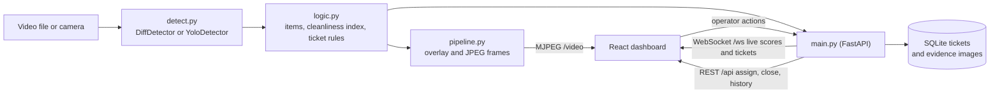

# Sweep

Facility hygiene and cleanliness (Track E): a fixed camera watches a floor area, the system finds litter and overflowing bins,
scores each zone from 0 to 100, opens a maintenance ticket when something stays too long, and shows a before and after
picture when it is cleaned.

## Run it today (synthetic clip, no training)

```bash
python -m venv .venv && source .venv/bin/activate        # Windows: .venv\Scripts\activate
pip install -r backend/requirements.txt
python tools/make_demo_clip.py                           # writes data/demo/floor.mp4 and reference.jpg (already in the zip)
cd backend && uvicorn main:app --port 8000
```

Paths in `config.json` are relative to the project root, so you can start it from any folder. `http://localhost:8000/video` shows the annotated stream and `http://localhost:8000/docs` lists the API.
Tests: `python tests/test_logic.py`, `python tests/test_pipeline.py`, `python tests/test_demo_clip.py`.

The synthetic clip is 70 seconds and loops. Timeline: empty floor, two passers-by (4 to 14 s), a visitor drops a bottle, a wrapper,
a can and a paper ball (14 to 26 s), more passers-by while the litter sits there (30 to 40 s), a cleaner picks everything up (46 to 58 s).
Expect four tickets, one per item, opening between about 29 and 43 s and closing between about 55 and 63 s. Say in your demo and
README that this clip is synthetic; the brief allows it.

## Dashboard (React)

Start the backend first (above), then in a second terminal:

```bash
cd frontend
npm install
npm run dev          # opens on http://localhost:5173
```

Vite proxies `/api`, `/video`, `/evidence` and `/ws` to the backend on port 8000 (see `frontend/vite.config.js`), so the page needs no URLs or CORS setup.
It shows the live annotated feed, a cleanliness card and score history for each zone, the housekeeping tracker with Open, Assigned and Cleaned tabs,
and a ticket review panel with the before and after frames, staff assignment and a manual "Mark cleaned". If the backend is down, the header says Offline and the page reconnects by itself.
`npm run build` writes a static copy to `frontend/dist`.

## Switching to your own footage later

1. Save the clip as `data/demo/floor.mp4`. It needs a fixed camera, and the first seconds must show an empty floor.
2. `python tools/grab_reference.py data/demo/floor.mp4 0` saves that empty frame as the reference.
3. `python tools/draw_zones.py data/demo/floor.mp4`, then paste the polygons into `zones` in `backend/config.json`.
4. Set `"person_model": "yolov8n.pt"` so walking people are masked out. The synthetic clip does not need it.
5. Tune `diff.threshold` (lower finds fainter litter, higher ignores noise) and `rules.still_px` for your frame size.

## Two detectors, one switch in config.json

| `detector` | What it does | Use it for |
|---|---|---|
| `diff` (default) | Compares each frame in colour with a clean reference image and reports new blobs that stay. People are masked out with a COCO person model. Needs no training. | First run, staged demos |
| `yolo` | Your fine-tuned litter model from `train/train.py`. `class_map` maps dataset class names to litter, debris, bag or overflow. | The accurate version, and the one with a real "model choice" to defend |

## How the numbers work (all in config.json)

- An item counts once it has been seen for `confirm_s` seconds (3), which filters flicker and hands passing through.
- Anything that moves more than `still_px` pixels (20) restarts its timer, so people and carried bags are not litter until they stop. A blob that suddenly doubles or halves in size is treated as a person walking past it, not as the same item.
- Penalty per item = class weight x (1 + min(age / age_ref, 2)). Weights: litter 6, debris 6, bag 12, overflow 25. A coverage term adds up to 30 more points when litter covers a large part of the zone.
- Cleanliness index = 100 minus the penalties, floored at 0. Bands: Clean 85 and above, Fair 60 to 84, Poor below 60.
- A ticket opens when an item has stayed `ticket_after_s` seconds (15 in the demo config; use 300 or more in a real deployment).
- A ticket closes as Cleaned when its item has been gone for `clean_after_s` seconds (5) and the "after" frame is saved. A supervisor can also close it by hand.
- With a video file, all of these thresholds run on footage time, so they mean the same thing however slow your laptop is.
- When the clip loops, tickets from the previous pass become Archived, so the demo starts clean each time.

## Architecture diagram



## Architecture

```
video file / camera
  -> detect.py     DiffDetector or YoloDetector
  -> logic.py      item tracking, cleanliness index, ticket triggers (pure Python, unit-tested)
  -> pipeline.py   overlay drawing, MJPEG frames, before/after capture
  -> main.py       FastAPI: REST (tickets, assign, close, replay), WebSocket (live), MJPEG (/video)
  -> store.py      SQLite tickets, images under data/evidence/<ticket id>/before.jpg and after.jpg
  -> dashboard     zone scorecards, live feed, before/after view, housekeeping tracker (next step)
```

WebSocket messages on `/ws`: `hello` (first), `stats` (zone scores and items, twice a second), `ticket` (created or changed), `reset` (clip restarted).
Ticket fields: `id, zone, type, priority, status, staff, created, assigned, cleaned, note, before_url, after_url`.

## Datasets for training the `yolo` detector (all open, check each page before you rely on it)

| Dataset | Contents | Licence shown on its page |
|---|---|---|
| Roboflow "garbage detection" by Kabam Robotics: universe.roboflow.com/kabam-robotics/garbage-detection-esaqp | about 3.5k images, 14 classes incl. garbage, garbage_bin, overflow | CC BY 4.0 |
| Roboflow "garbage detection" by kabam: universe.roboflow.com/kabam/garbage-detection-bnn5b | classes garbage, garbage_bin, overflow | CC BY 4.0 |
| Roboflow "vlm-waste 2" by Kontakt: universe.roboflow.com/kontakt/vlm-waste-2 | classes Closed, Opened, Overflow, Scattered Garbage | CC BY 4.0 |
| TACO: github.com/pedropro/TACO, mirror on Zenodo (record 3587843, 2.7 GB) | 1500 images, 60 litter classes, segmentation masks | code MIT, annotations CC BY 4.0 |

For a first model, start with the Kabam Robotics set: it has an "overflow" class that TACO lacks. TACO adds outdoor litter variety but needs its many small classes merged into one `litter` class before training. Cite whichever you use in your README.

The expected results for the demo clip are in `data/demo/EXPECTED.md`.

## Known limits

- The diff detector assumes a fixed camera and steady lighting. A person standing still in the reference frame will be treated as part of the floor, so grab the reference when the area is empty.
- Litter that is the same colour as the floor will be missed by the diff detector. A trained model handles this better.
- Overflowing bins are only recognised by the `yolo` detector.
- Before/after images are saved as full frames, not cropped to the item.
- CORS is open for development. Restrict it before any real deployment.

## Licences to list

| Component | Licence |
|---|---|
| Ultralytics YOLO (code and yolov8 weights) | AGPL-3.0 |
| OpenCV | Apache-2.0 |
| FastAPI, Uvicorn | MIT, BSD-3 |
| SQLite | Public domain |
| Training datasets | see table above |

If you want to avoid AGPL, use the `diff` detector only, or train an Apache-2.0 detector such as YOLOX.
